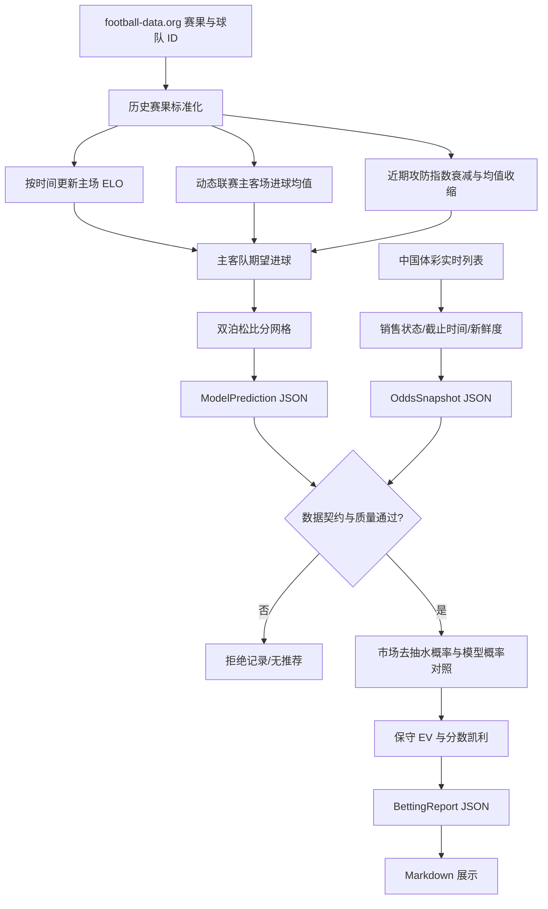

# 五大联赛预测与投注计算流程

- 受众：模型维护者、数据 connector 维护者和审核人员
- 前置条件：理解十进制赔率、ELO 和泊松分布；接口字段以 `schemas/` 为准

## 数据流

## 俱乐部 ELO

比赛按开球时间排序。主队赛前期望为：

$$E_h=\frac{1}{1+10^{-((R_h+H)-R_a)/400}}$$

赛果 $S_h$ 分别取 1、0.5、0，并按 $K(S_h-E_h)$ 更新两队评级。`H`、`K` 和初始评级全部记录在预测 JSON 中。

## 进球参数

系统从输入历史现场计算联赛主客场平均进球。球队最近比赛使用指数衰减，并向联赛球队均值收缩：

$$\bar g_{shrunk}=\frac{w\bar g+n_0\bar g_{league}}{w+n_0}$$

主队期望进球由联赛主场均值、主队进攻比率、客队防守比率和中立 ELO 强度因子计算；客队使用对应客场参数。实现设置正数上下限以防止异常输入放大。

## 比分与玩法概率

给定主客队期望进球 $\lambda$、$\mu$：

$$P(X=x,Y=y)=\frac{e^{-\lambda}\lambda^x}{x!}\frac{e^{-\mu}\mu^y}{y!}$$

归一化比分网格派生：

- HAD：主胜、平、客胜；
- HHAD：把让球数加入主队实际进球后重新聚合；
- TTG：0 至 6 球以及 7+；
- CRS：中国竞彩明确比分和胜/平/负其他。

## 赔率与资金

同一完整玩法的去抽水市场概率：

$$P_{market,i}=\frac{1/O_i}{\sum_j 1/O_j}$$

市场概率只用于对照。模型概率 $p$ 先减去显式风险缓冲 $h$：

$$p_c=\max(0,p-h),\quad EV_{low}=p_cO-1$$

通过门槛后使用分数凯利：

$$f=\alpha\frac{p_cO-1}{O-1}$$

实际金额为 `bankroll × f`，再按投注单位向下取整。单项和总敞口分别受限，未使用的本金保留为现金。

## 错误关闭状态

以下条件不会降级生成建议：赔率合同无效、快照过期、停售、截止时间已过、球队映射不唯一、比赛时间不一致、预测历史不足、模型快照过期或保守 EV 未过线。

## 当前限制

- 默认参数尚未完成逐联赛 walk-forward 校准，JSON 会明确记录 `baseline_pending_walk_forward`。
- 伤停、预计首发、天气和裁判目前没有结构化且经过校准的 connector，不直接修改概率。
- 固定概率折减是风险缓冲，不是统计置信区间。
- 串关启用时暂按跨场独立计算，仍可能存在未建模相关性。
