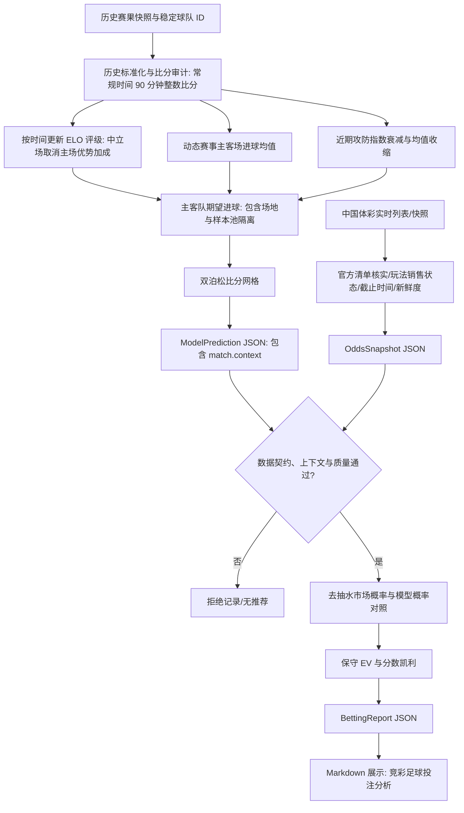

# 竞彩足球预测与投注计算流程

- 受众：模型维护者、数据 connector 维护者和审核人员
- 前置条件：理解十进制赔率、ELO 和泊松分布；接口字段以 `schemas/` 为准

## 数据流

## 通用 ELO 与中立场处理

比赛按开球时间排序。当 `match.context.venue == "home"` 时，主队赛前期望为：

$$E_h=\frac{1}{1+10^{-((R_h+H)-R_a)/400}}$$

当 `match.context.venue == "neutral"` 时，中立场双向取消主场优势加成（$H=0$）：

$$E_h=\frac{1}{1+10^{-(R_h-R_a)/400}}$$

若场地状态为 `unknown`，系统直接以 `venue_unknown` 拒绝，不设默认主场优势。
赛果 $S_h$ 分别取 1、0.5、0，并按 $K(S_h-E_h)$ 更新两队评级。`H`、`K` 和初始评级全部记录在预测 JSON 中。

## 进球参数与样本池隔离

系统从输入历史现场计算赛事主客场平均进球。球队最近比赛使用指数衰减，并向基准均值收缩：

$$\bar g_{shrunk}=\frac{w\bar g+n_0\bar g_{league}}{w+n_0}$$

- **中立场修正**：中立场比赛进球期望取消主场基线修正，双方使用对称的期望进球计算。
- **样本池物理隔离**：俱乐部赛事样本池与国家队样本池严禁混合；跨赛事样本池必须显式声明并验证图连通性；所有样本图连通性判定仅使用目标比赛开球时间之前的样本，杜绝未来信息泄漏。

## 比分与玩法概率

比分严格限定为常规时间 90 分钟（含伤停补时）比分，加时与点球大战予以剔除。给定主客队期望进球 $\lambda$、$\mu$：

$$P(X=x,Y=y)=\frac{e^{-\lambda}\lambda^x}{x!}\frac{e^{-\mu}\mu^y}{y!}$$

归一化比分网格派生：
- **HAD**：主胜、平、客胜；
- **HHAD**：把让球数加入主队实际进球后重新聚合；
- **TTG**：0 至 6 球以及 7+；
- **CRS**：中国竞彩明确比分和胜/平/负其他。

## 赔率与资金

同一完整玩法的去抽水市场概率：

$$P_{market,i}=\frac{1/O_i}{\sum_j 1/O_j}$$

市场概率仅用于对照。模型概率 $p$ 先减去显式风险缓冲 $h$：

$$p_c=\max(0,p-h),\quad EV_{low}=p_cO-1$$

通过门槛后使用分数凯利：

$$f=\alpha\frac{p_cO-1}{O-1}$$

实际金额为 `bankroll × f`，再按投注单位向下取整。单项和总敞口分别受限，未使用的本金保留为现金。

## 错误关闭状态（Fail-Closed）

以下任一条件触发时，系统不会降级生成建议，直接输出拒绝原因：
- 官方清单未核实（`official_listing.status != "confirmed"`）；
- 玩法停售或状态未知（`market_status[market] != "open"`）；
- 赔率快照时效超期（> 15 分钟）或开球时间容差超期（> 15 分钟）；
- 历史数据来源未经验证（`provenance_status != "verified"`）；
- 比分数据非整数或含有加时点球；
- 场地为未知（`venue == "unknown"`）或俱乐部/国家队样本池混淆；
- 球队映射不唯一或模型历史场数不足；
- 保守 EV 未过线或凯利仓位为 0。

## 当前限制

- 默认参数尚未完成逐联赛 walk-forward 校准，JSON 会明确记录 `baseline_pending_walk_forward`。
- 伤停、预计首发、天气和裁判目前没有结构化且经过校准的 connector，不直接修改概率。
- 固定概率折减是风险缓冲，不是统计置信区间。
- 串关启用时暂按跨场独立计算，仍可能存在未建模相关性。
- 数据接入覆盖不等于业务范围：虽然系统支持全部竞彩赛事，但特定赛事（如小联赛或杯赛）的实际预测能力取决于历史数据的完备性。
