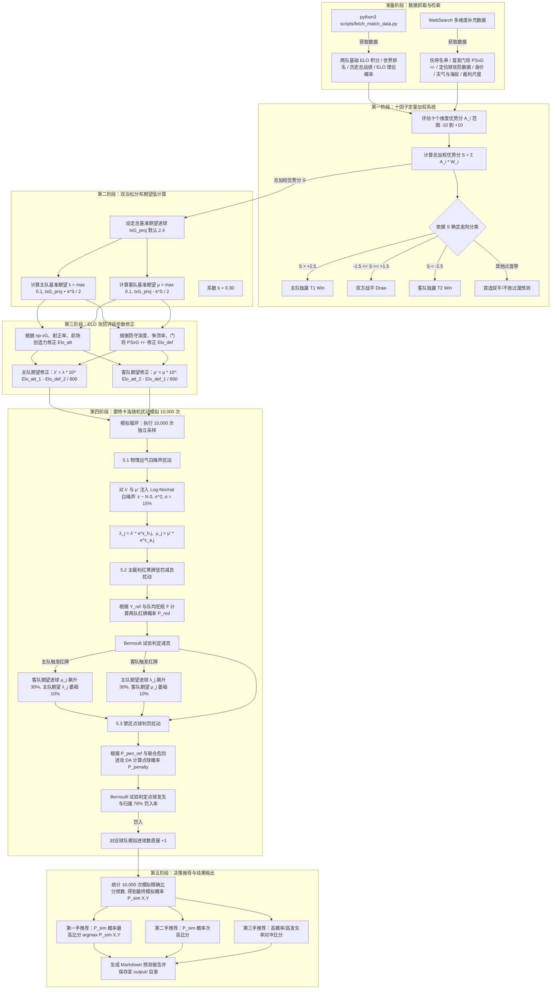

# 通用足球体彩比赛预测精算流程与计算图

本文件详细记录了根据 `@.cursor/skills/match-prediction/SKILL.md` 实现的足球比赛结果定量加权预测与随机扰动蒙特卡洛（Monte Carlo）模拟精算流程。

---

## 一、 精算预测总体计算流程图 (Mermaid)

---

## 二、 核心精算公式数学描述

### 1. 优势分转换进球期望
$$\lambda_{base} = \max\left(0.1, \frac{txG_{proj} + k \cdot S}{2}\right)$$
$$\mu_{base} = \max\left(0.1, \frac{txG_{proj} - k \cdot S}{2}\right)$$
*参数设定*：总期望进球 $txG_{proj} = 2.4$，转换系数 $k = 0.30$，优势分 $S \in [-10, 10]$。

### 2. ELO 攻防战力修正
$$\lambda' = \lambda_{base} \times 10^{\frac{Elo_{att, 1} - Elo_{def, 2}}{800}}$$
$$\mu' = \mu_{base} \times 10^{\frac{Elo_{att, 2} - Elo_{def, 1}}{800}}$$

### 3. 随机扰动机制（蒙特卡洛单次采样）
- **物理运气白噪声**：
  $$\lambda_j = \lambda' \cdot e^{\epsilon_{h, j}}, \quad \mu_j = \mu' \cdot e^{\epsilon_{a, j}}, \quad \epsilon \sim N(0, \sigma^2), \quad \sigma = 0.15$$
- **红牌减员因子**：
  $$P_{red, h} = \min\left(0.15, \frac{Y_{ref}}{4.5} \times \frac{F_{home}}{12.0} \times 0.06\right), \quad P_{red, a} = \min\left(0.15, \frac{Y_{ref}}{4.5} \times \frac{F_{away}}{12.0} \times 0.06\right)$$
- **点球判罚因子**：
  $$P_{penalty} = \min\left(0.40, P_{pen, ref} \times \frac{DA_{home} + DA_{away}}{75.0} \times 0.8\right)$$
  点球归属概率为：$P_{pen\_to\_home} = \frac{DA_{home}}{DA_{home} + DA_{away}}$，罚入率 $76\%$。
